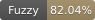
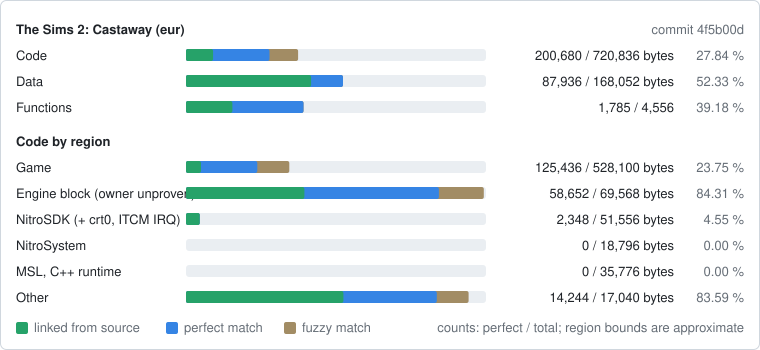

The Sims 2: Castaway (Nintendo DS)
==================================

A work-in-progress matching decompilation of The Sims 2: Castaway for the Nintendo
DS, built with [ds-decomp](https://github.com/AetiasHax/ds-decomp).

This repository does **not** contain any game assets or assembly whatsoever. An existing
copy of the game is required.

Supported versions:

- `eur`: `YS2P`, Rev 0 (Europe)

Progress
========

| Release | Game code | Progress |
|---|---|---|
| The Sims 2: Castaway (Europe) | `YS2P` | [](notes/PROGRESS.md) [](notes/PROGRESS.md) [](notes/PROGRESS.md) |

[](notes/PROGRESS.md)

- **Fuzzy**: objdiff fuzzy match score over all code.
- **Perfect**: code that matches byte for byte.
- **Linked**: code built from source (`complete` files of `delinks.txt`).

The badges and the card are drawn from the objdiff report by
`tools/progress_badges.py`. After a build, `python tools/progress_badges.py --record`
redraws `progress/eur/` and adds the current commit to `progress/eur/history.csv`;
commit the `progress/` folder with it.

Dependencies
============

- [Python](https://www.python.org/downloads/) 3.10+ in `%PATH%`, then
  `pip install -r tools/requirements.txt`.
- [ninja](https://github.com/ninja-build/ninja/releases) in `%PATH%`
  (`pip install ninja` works too).
- On Windows use native tooling; WSL or msys2 are not required. On Linux,
  [wibo](https://github.com/decompals/wibo) is downloaded to run the compiler.

dsd, objdiff-cli and the mwccarm compilers are downloaded by the first `ninja` run.

Building
========

1. Copy the ROM to `extract/baserom_ts2c_eur.nds`
   (SHA-1 `035eb8f242d3c83acb478b313e1b135c6aebc76d`).
2. Optional: copy your own `arm7_bios.bin` to the repository root to check the
   original ROM SHA-1 (without it the secure area is not encrypted, see `SPEC.md`).
3. Run:

   ```
   python tools/configure.py
   ninja
   ```

   The first `ninja` only downloads the tools and reruns `configure.py`; run `ninja`
   again. A build ends with `build\eur\ts2c_eur.nds: OK`.

Diffing
=======

`ninja objdiff` writes `objdiff.json`; open the repository folder in
[objdiff](https://github.com/encounter/objdiff). `ninja report` writes
`build/eur/report.json`.

Documentation
=============

- `SPEC.md`: target ROM, toolchain, acceptance criteria, naming.
- `ROADMAP.md` and `TASKS.md`: phases and current work.
- `notes/`: compiler evidence, region map, matching techniques, Ghidra setup,
  references and provenance of reused code.
